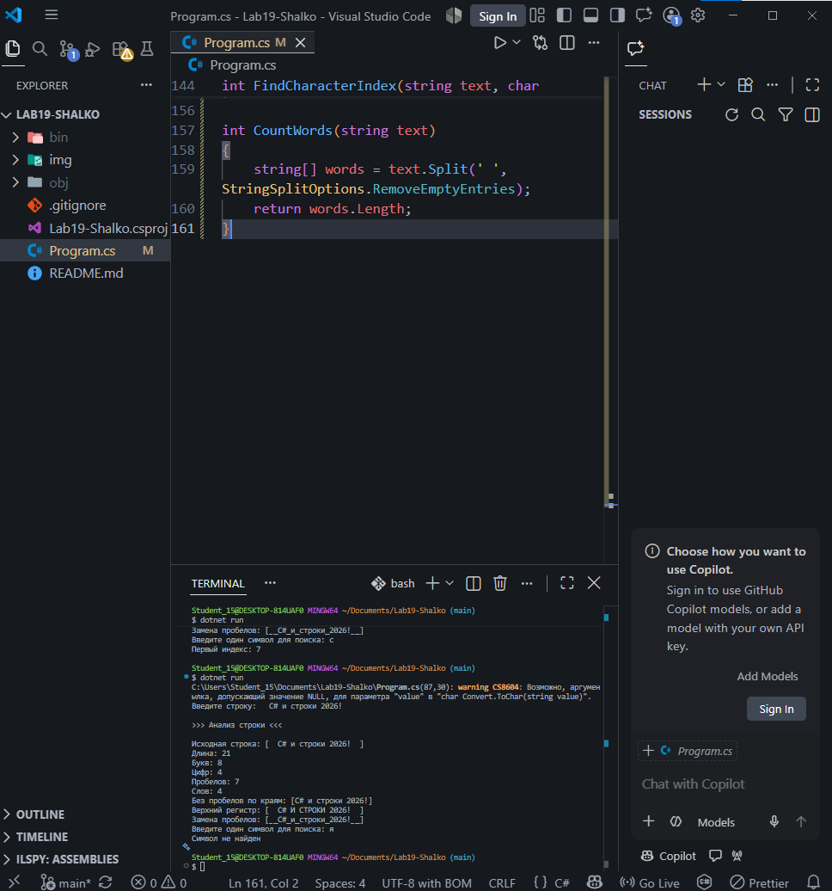

# Практическая работа №19

Автор: Шалько Андрей
Группа: ИСП-252

## Тема

Строки в C#.

## Что реализовано

- определение длины строки;
- подсчёт букв, цифр, пробелов и слов;
- поиск первого индекса символа;
- удаление пробелов по краям;
- перевод в верхний регистр;
- замена пробелов на подчёркивания;

## Короткие ответы

1. Чем отличаются `string` и `char`?

Ответ: Тип `string` представляет собой последовательность символов и записывается в двойных кавычках, а тип `char` хранит только один одиночный символ и записывается в одиночных кавычках.

2. Почему вызов `text.Trim()` без сохранения результата не меняет `text`?

Ответ: Метод `Trim()` не изменяет исходную строку, а создаёт и возвращает новую строку без крайних пробелов, поэтому её нужно присвоить переменной.

3. Зачем при разделении строки используется `RemoveEmptyEntries`?

Ответ: Этот параметр заставляет метод `Split()` пропускать пустые подстроки, которые  возникают, если в тексте есть пробелы в начале, в конце или несколько пробелов подряд.

## Результат

